# Figure atlas and interpretation notes

All 12 PNG figures are in `reference_figures/`.  These are **exploratory figures**; manuscript figures should be re-rendered from validated cohort data.

### Figure 01: 01_age_distribution.png

Input age structure. Four age groups used subsequently: <1, 1-<3, 3-<7, >=7 years.

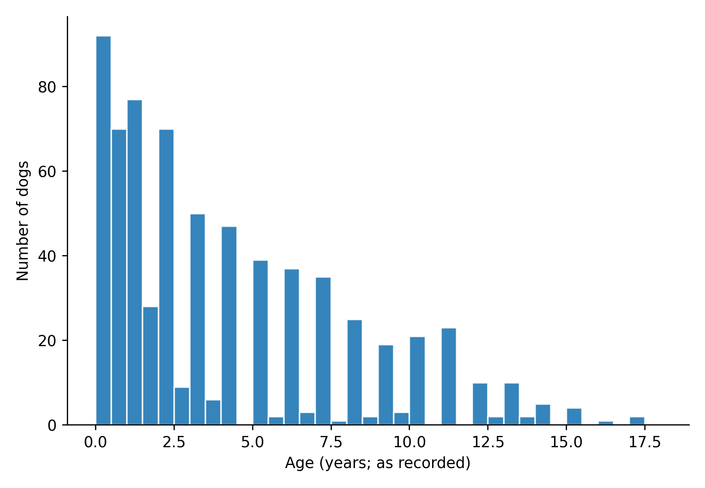

### Figure 02: 02_pathway_age_volcano.png

Correlation magnitude versus -log10 BH q-value for 309 filtered pathways. Multiple pathway definitions may be correlated.

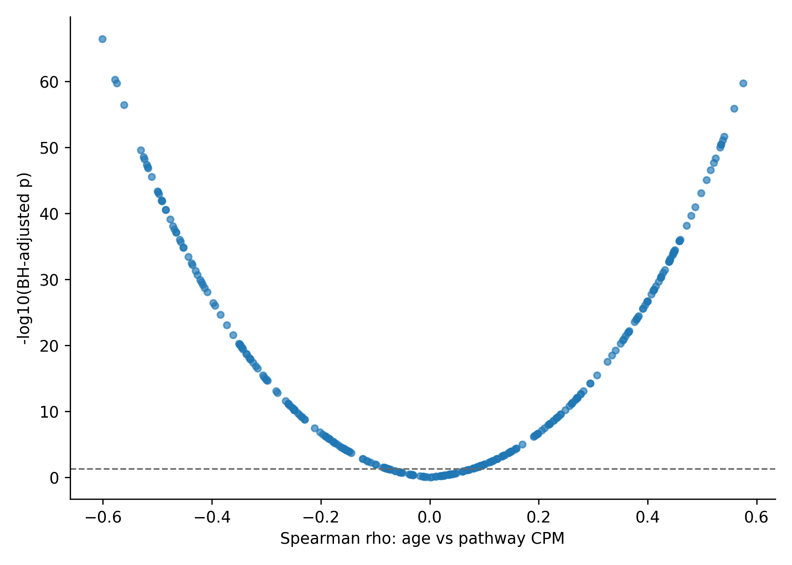

### Figure 03: 03_raw_vs_clr_age_correlations.png

Age correlation direction agreement between CPM and CLR(log(CPM+1)) sensitivity.

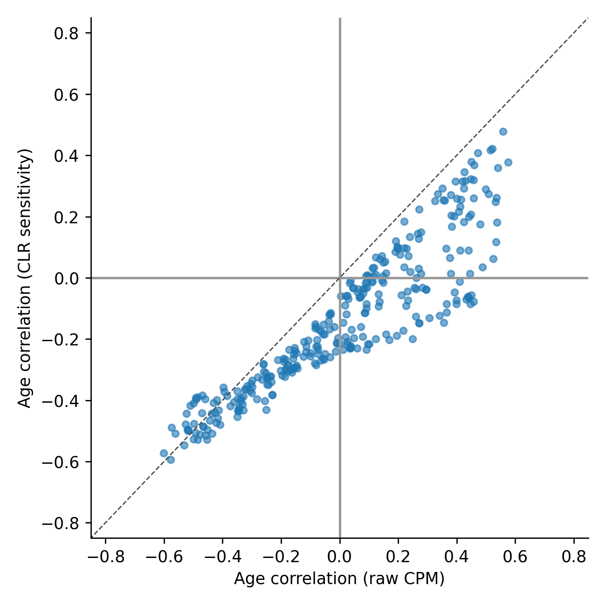

### Figure 04: 04_top_robust_pathways_vs_age.png

Representative high-significance age trajectories; LOWESS is descriptive.

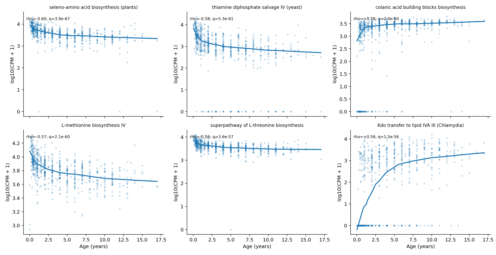

### Figure 05: 05_provisional_functional_categories_by_age.png

NOT for manuscript as a MetaCyc plot: keyword category sums are provisional.

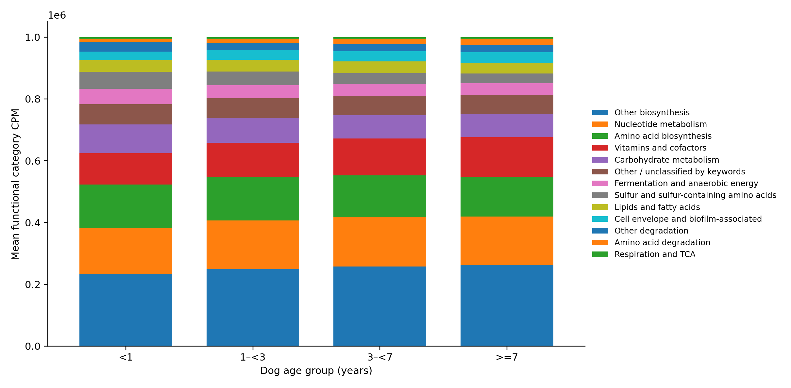

### Figure 06: 06_clr_pathway_pca_by_age.png

Community functional composition PCA; PC1 variance 14.9%, age association rho +0.574.

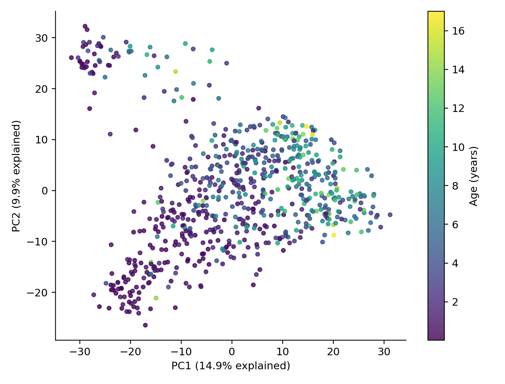

### Figure 07: 07_pathway_detection_vs_age.png

Number of observed pathways; age correlation may be sequencing-depth-confounded.

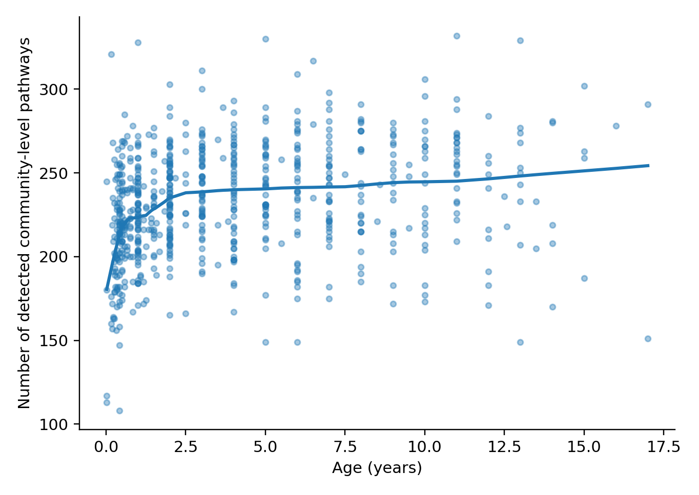

### Figure 08: 08_selected_metabolic_hypothesis_pathways.png

Mechanistic leads: histidine, purines, lysine, denitrification, fucose, mixed-acid fermentation. Several have weak coverage.

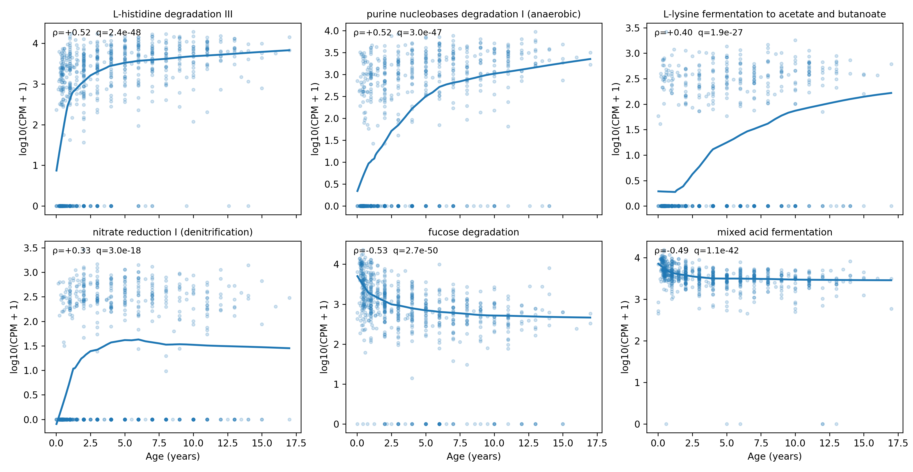

### Figure 09: 09_selected_pathway_abundance_vs_coverage.png

Visual diagnostic showing why abundance and coverage should not be treated interchangeably.

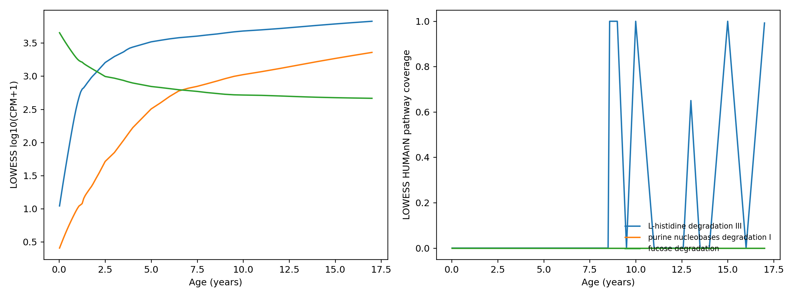

### Figure 10: 10_coverage_supported_age_pathways.png

PRIORITY: six stronger coverage-supported age trajectories; note counterexamples to anaerobic generalization.

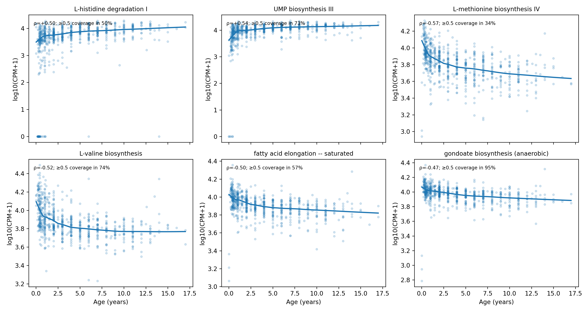

### Figure 11: 11_age_group_supported_pathway_heatmap.png

PRIORITY: age-group mean standardized log(CPM+1) for selected comparatively well covered pathways.

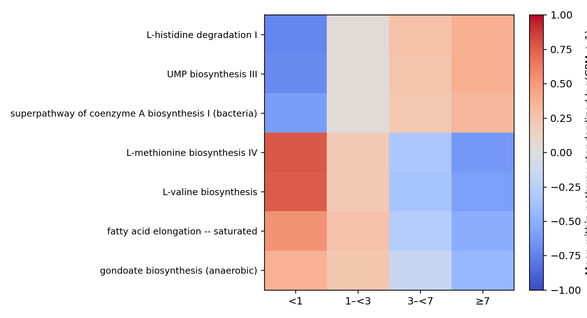

### Figure 12: 12_age_vs_weight_pathway_correlations.png

Contrasts age and weight Spearman trends; cohorts differ because weight is missing in 69 dogs.

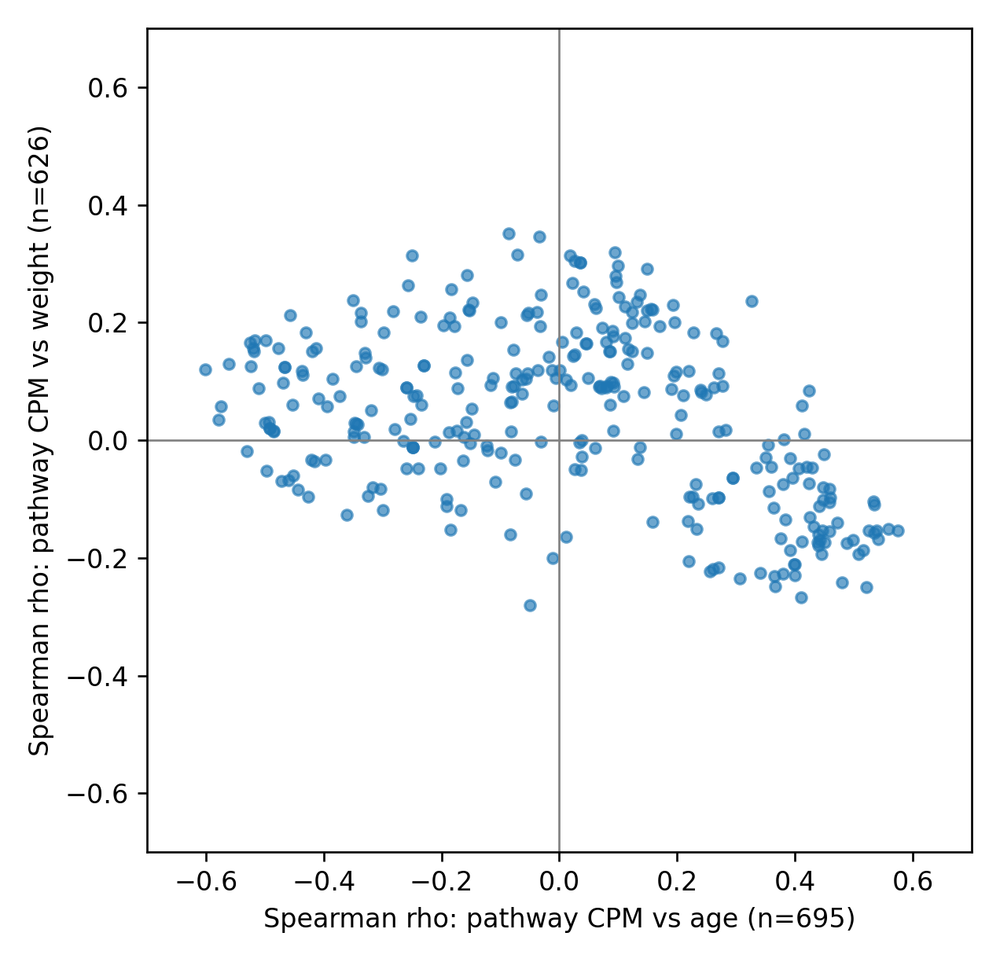
